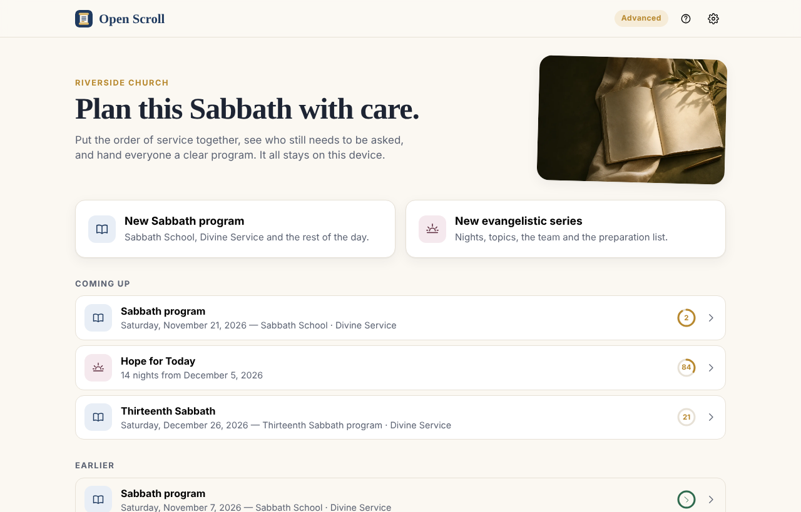
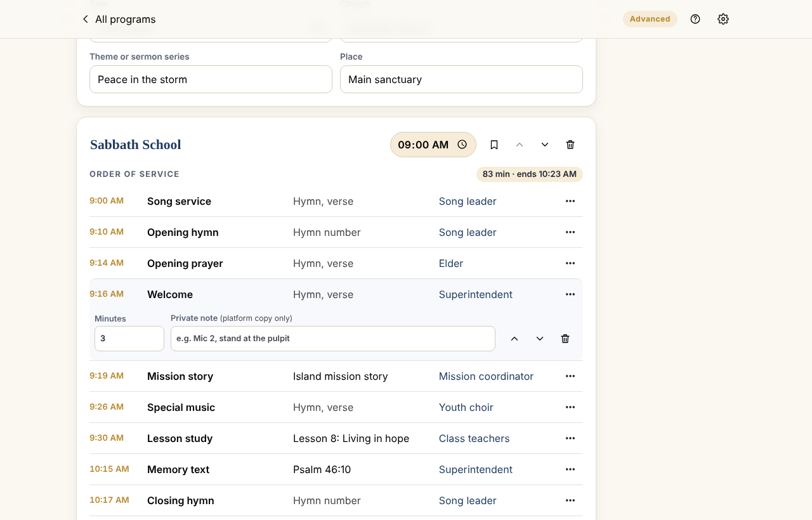
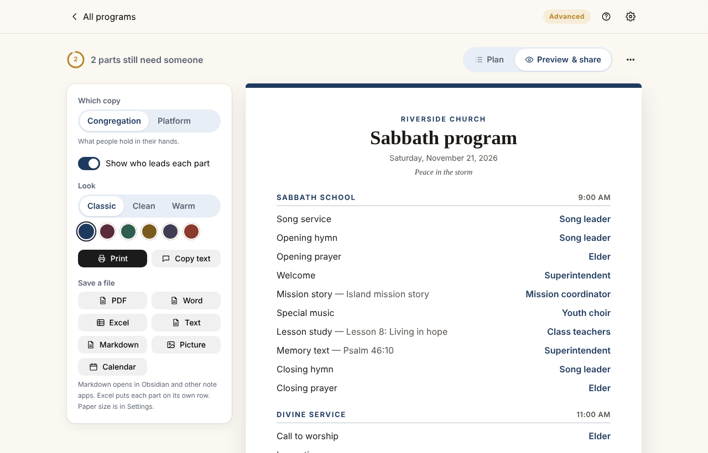
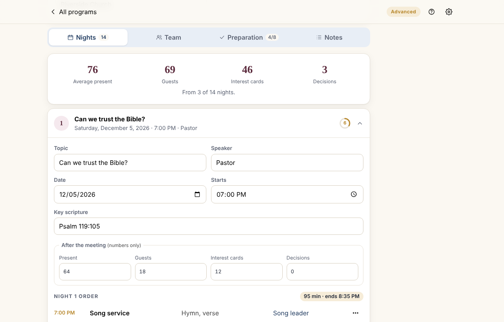
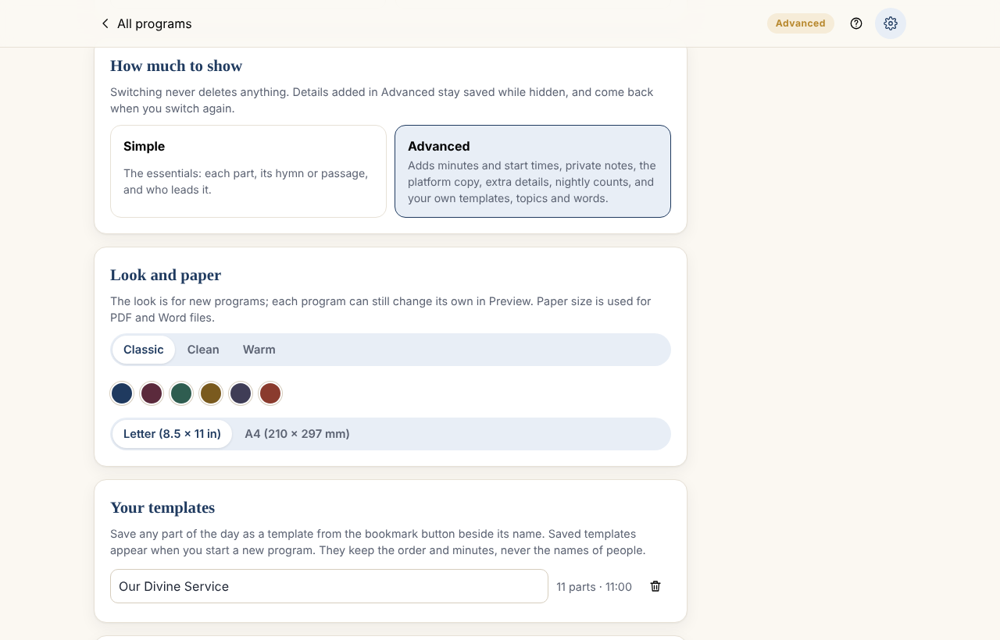
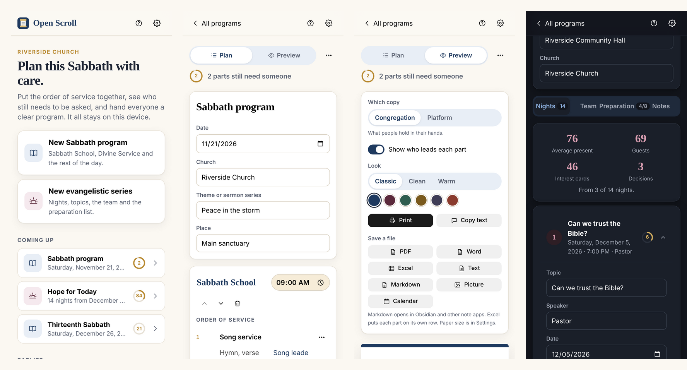
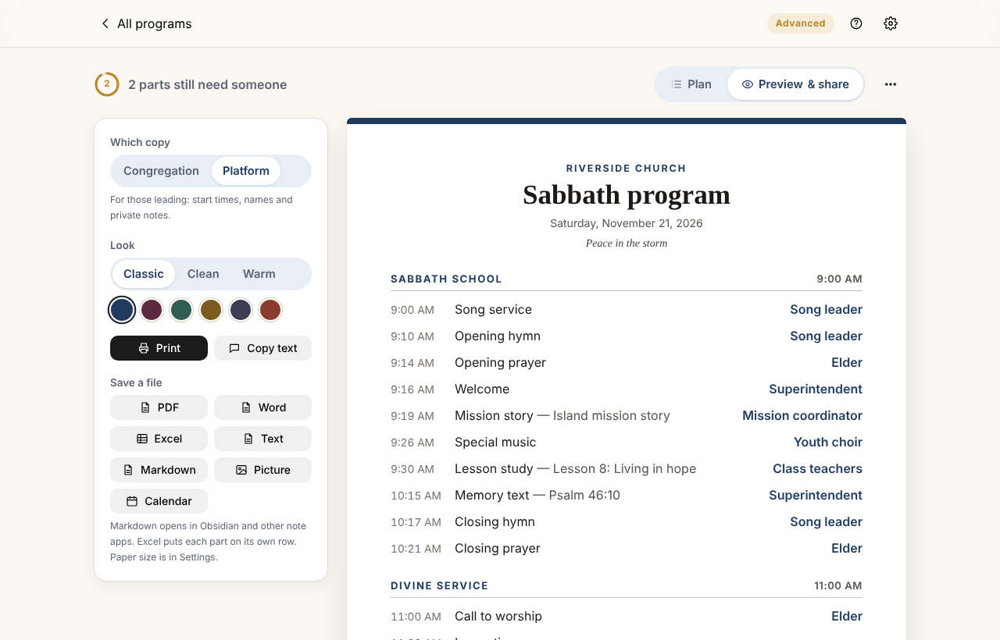

<p align="center">
  
</p>

<h1 align="center">Open Scroll</h1>

<p align="center">
  Plan the day of worship and evangelistic meetings.<br>
  Private, free and open source.
</p>

<p align="center">
  
</p>

Open Scroll helps a church plan its day of worship and its evangelistic meetings, make them its own, and hand everyone a clear program. It runs in the browser, needs no account, and keeps every program on the device it was made on.

It speaks the words your church uses:
- Choose **Seventh-day Adventist** and it plans the Sabbath: Sabbath School, the Divine Service and an evangelistic series.
- Choose **another church tradition** and the same tools plan Sunday School, the worship service and an outreach series.

## A look around

All pictures are the real app with made-up sample data.

| Plan the order of service | Preview and share |
| :---: | :---: |
|  |  |
| **Plan a series of meetings** | **Make it your own** |
|  |  |

<p align="center">
  
</p>

## Simple or Advanced

You choose when Open Scroll first opens, and can change it any time in **Settings**. Switching never deletes anything: details added in Advanced stay saved while hidden.

| | Simple | Advanced |
| --- | :---: | :---: |
| Start from a familiar order of service | ✓ | ✓ |
| Each part with its hymn, passage or title, and who leads it | ✓ | ✓ |
| A ring counting the parts that still need someone | ✓ | ✓ |
| Evangelistic series with dates, topics, team and preparation list | ✓ | ✓ |
| Print, copy text, save a picture, add to calendar | ✓ | ✓ |
| Save as PDF, Word, Excel, text or Markdown | ✓ | ✓ |
| Copy for next week, make a copy, undo | ✓ | ✓ |
| Minutes, start times and when each part of the day ends | | ✓ |
| Private notes and a platform copy for those leading | | ✓ |
| Extra details such as *Offering for* or *Deacons on duty* | | ✓ |
| Plan up to 26 weeks at once, ending on a Thirteenth Sabbath | | ✓ |
| Nightly counts for a series: present, guests, interest cards, decisions | | ✓ |
| Your own templates, topic lists and words | | ✓ |

## Make it your church's own

- **Your templates.** Shaped a part of the day the way your church does it? Save it from the bookmark beside its name, and it appears whenever you start a new program. Templates keep the order and minutes, never people's names.
- **Your topic lists.** Keep the topics your evangelist preaches, and pick them when you start the next series.
- **Your words.** If your church says "Worship Hour" instead of "Divine Service", or "Evening" instead of "Night", change it once in Settings and Open Scroll uses your words everywhere.
- **Your look.** Choose the style and colour new programs start with, and change any single program in Preview.
- **Your data.**
  - Download a backup file to keep it safe or move it to another device.
  - Bringing a backup in only adds what is missing, and on a new device it brings your settings too.
  - Erasing everything always asks first.

## Take it with you

From **Preview & share**, save the program you are looking at as a file. Every file is made on your device, never uploaded, and follows the copy you chose: a congregation copy never contains private notes, and the platform copy adds start times, leaders and notes.

| File | Good for |
| --- | --- |
| **PDF** | Sending or printing. Real, selectable text on Letter or A4. |
| **Word** (.docx) | Editing further, or a church office that works in Word. Opens in Word, LibreOffice and Google Docs. |
| **Excel** (.xlsx) | Planning in a spreadsheet: one row per part, with a Nights sheet for a series, plus Team and Preparation sheets on the platform copy. Counts for each night are added in Advanced. |
| **Text** (.txt) | Pasting into a message, an email or any app. |
| **Markdown** (.md) | Obsidian and other note apps. It has properties at the top (title, church, date, type), headings, lists and callouts, and typed text can never turn into links or formatting. |
| **Picture** (.png) | A group chat or a church page. |
| **Calendar** (.ics) | Putting the dates in a phone or computer calendar. |

Choose Letter or A4 paper in Settings. The PDF uses the standard Western European fonts that every PDF reader has, so text in other alphabets (such as Chinese or Arabic) shows as "?" in the PDF, and Open Scroll tells you when that happens. Word, Excel, Text and Markdown keep every character, and **Print, then Save as PDF** in your browser keeps them in a PDF.

## Templates included

| Seventh-day Adventist | Another church tradition |
| --- | --- |
| Sabbath School, and a mission-focus Sabbath School | Sunday School |
| Thirteenth Sabbath program | Worship service |
| Divine Service | Communion service |
| Communion service (ordinance of humility and the Lord's Supper) | Evening service |
| Afternoon program (AY) | Prayer meeting |
| Sunset vespers | |
| Evangelistic night, with a Bible prophecy or a health-and-hope topic list | Outreach night, with a questions-of-life or revival-week topic list |

Every template is a starting point drawn from published practice. [docs/RESEARCH.md](./docs/RESEARCH.md) explains each one and lists its sources. No hymn titles or numbers are included: hymnals belong to their publishers, and every church sings its own.

The platform copy adds start times, leaders and private notes for those leading:

<p align="center">
  
</p>

## Your privacy

- Open Scroll has no server and makes no network requests; its Content Security Policy forbids them.
- Programs, templates and settings are stored only in this browser.
- PDF, Word, Excel, text, Markdown, picture, calendar and backup files are all made on the device.
- A series keeps nightly numbers only, never the names of guests. Those belong in your church's own secure records.
- Clearing the browser's site data removes everything, so download a backup now and then.

## Run it yourself

Use Node.js 22.12 or newer and pnpm.

```sh
pnpm install --frozen-lockfile
pnpm test
pnpm build
pnpm preview --host 127.0.0.1
```

Open the address Vite prints. Any static host can serve `dist/` over HTTPS; set `base` in a Vite config when serving from a sub-path.

## Contributing

Ideas, bug reports and pull requests are welcome. Please read [CONTRIBUTING.md](./CONTRIBUTING.md) first; it explains the few rules every change keeps. Report security problems privately as described in [SECURITY.md](./SECURITY.md). Everyone taking part follows the [Code of Conduct](./CODE_OF_CONDUCT.md). Changes from one version to the next are listed in [CHANGELOG.md](./CHANGELOG.md).

Open Scroll is built with React, the [Astryx](https://astryx.atmeta.com/) Neutral theme and [pdf-lib](https://pdf-lib.js.org/) (MIT, loaded only when you save a PDF). Word and Excel files are written directly, with no library. Its planning features were informed by the public documentation of [Open Sentry Beacon](https://github.com/Klydo131/Open-Sentry-Beacon).

## License

Open Scroll is released under the [MIT License](./LICENSE).
